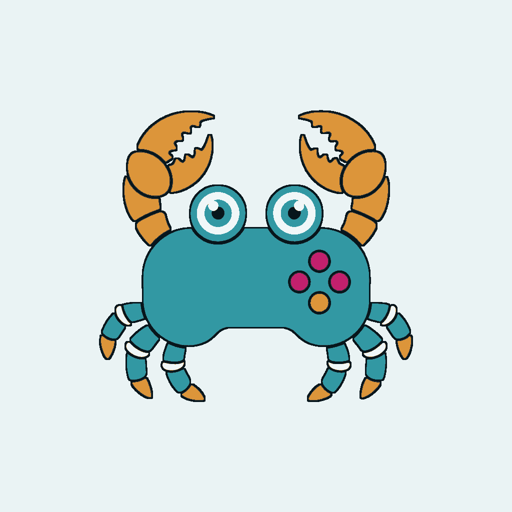

  <picture>
    <source media="(prefers-color-scheme: dark)" srcset="assets/header-dark.png">
    
  </picture>

  <a href="mailto:socheatrotanak@gmail.com">socheatrotanak@gmail.com</a>

I write local-first Windows tools in Rust. Download managers, game-library compression, DNS. I care about the boring parts: installers that register native hosts correctly, queues that resume, resolvers that fail over.

Second-year Digital Technologies student at AUPP. Coursework leans cybersecurity and networking.

<h3 align="center">Projects</h3>

<table align="center">
  <tr>
    <td align="center" width="33%" valign="top">
      <a href="https://github.com/JustNak/RusticDL">
        <picture>
          <source media="(prefers-color-scheme: dark)" srcset="assets/rusticdl.png">
          
        </picture>
      </a>
        
      <a href="https://github.com/JustNak/RusticDL"><strong>RusticDL</strong></a>
       
      Local-first HTTP(S) download manager
    </td>
    <td align="center" width="33%" valign="top">
      <a href="https://github.com/JustNak/RusticGU">
        <picture>
          <source media="(prefers-color-scheme: dark)" srcset="assets/rusticgu.png">
          
        </picture>
      </a>
        
      <a href="https://github.com/JustNak/RusticGU"><strong>RusticGU</strong></a>
       
      Compact a Steam library in place
    </td>
    <td align="center" width="33%" valign="top">
      <a href="https://github.com/JustNak/DNSBenchPro">
        <picture>
          <source media="(prefers-color-scheme: dark)" srcset="assets/dns-dark.png">
          
        </picture>
      </a>
        
      <a href="https://github.com/JustNak/DNSBenchPro"><strong>DNS Bench Pro</strong></a>
       
      DoH latency, measured in the browser
    </td>
  </tr>
</table>

<h3 align="center">Now</h3>

  Building the Rustic apps. Studying networking. 
  Breaking my own DNS setup on purpose, then putting it back.

