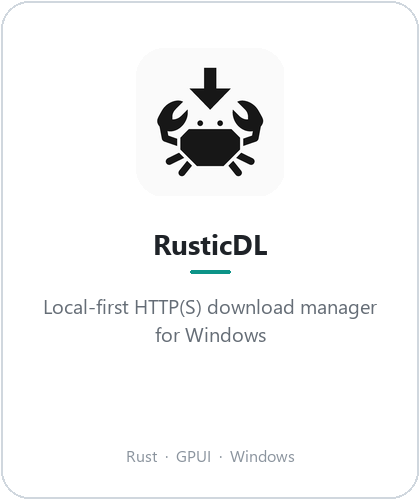
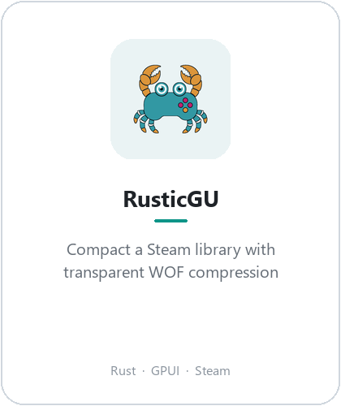
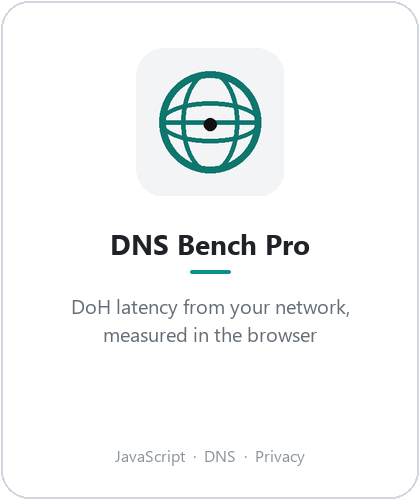
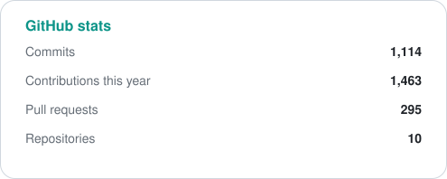
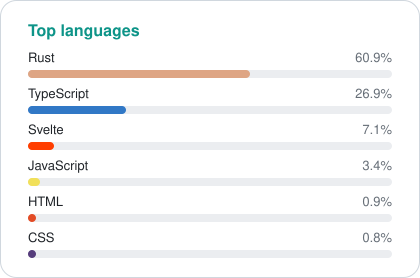
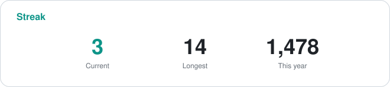

  <picture>
    <source media="(prefers-color-scheme: dark)" srcset="assets/header-dark.png">
    
  </picture>

  <a href="mailto:socheatrotanak@gmail.com">socheatrotanak@gmail.com</a>

  <picture>
    <source media="(prefers-color-scheme: dark)" srcset="https://skillicons.dev/icons?i=rust,js,ts,windows,linux,git,github&theme=dark">
    
  </picture>

I write local-first Windows tools in Rust. Download managers, game-library compression, DNS. I care about the boring parts: installers that register native hosts correctly, queues that resume, resolvers that fail over.

Second-year Digital Technologies student at AUPP. Coursework leans cybersecurity and networking.

<h3 align="center">Projects</h3>

  <a href="https://github.com/JustNak/RusticDL">
    <picture>
      <source media="(prefers-color-scheme: dark)" srcset="assets/rusticdl-card-dark.png">
      
    </picture>
  </a>
  <a href="https://github.com/JustNak/RusticGU">
    <picture>
      <source media="(prefers-color-scheme: dark)" srcset="assets/rusticgu-card-dark.png">
      
    </picture>
  </a>
  <a href="https://github.com/JustNak/DNSBenchPro">
    <picture>
      <source media="(prefers-color-scheme: dark)" srcset="assets/dns-card-dark.png">
      
    </picture>
  </a>

<h3 align="center">Stats</h3>

<table align="center">
  <tr>
    <td valign="top">
      <picture>
        <source media="(prefers-color-scheme: dark)" srcset="assets/stats-dark.svg">
        
      </picture>
    </td>
    <td valign="top">
      <picture>
        <source media="(prefers-color-scheme: dark)" srcset="assets/langs-dark.svg">
        
      </picture>
    </td>
  </tr>
</table>

  <picture>
    <source media="(prefers-color-scheme: dark)" srcset="assets/streak-dark.svg">
    
  </picture>

<h3 align="center">Now</h3>

  Building the Rustic apps. Studying networking. 
  Breaking my own DNS setup on purpose, then putting it back.

