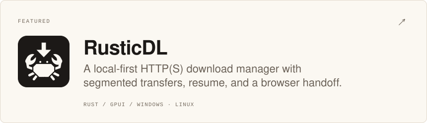
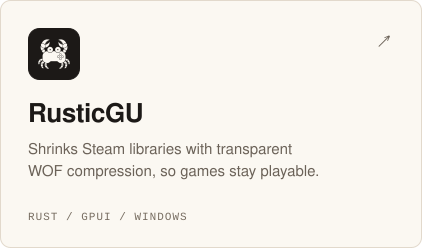
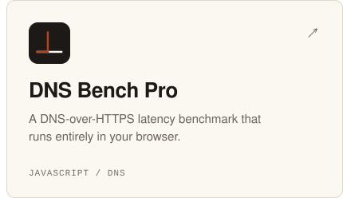
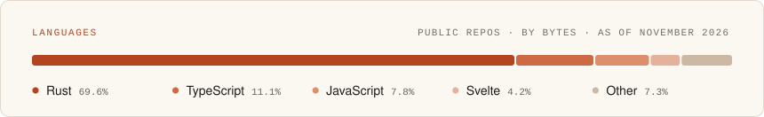

  <picture>
    <source media="(prefers-color-scheme: dark)" srcset="assets/header-dark.svg">
    
  </picture>

Building the Rustic apps and studying networking. Breaking my own DNS setup on purpose, then putting it back.

## Selected work

<a href="https://github.com/JustNak/RusticDL"><picture><source media="(prefers-color-scheme: dark)" srcset="assets/rusticdl-card-dark.svg"></picture></a>

<a href="https://github.com/JustNak/RusticGU"><picture><source media="(prefers-color-scheme: dark)" srcset="assets/rusticgu-card-dark.svg"></picture></a><!--
--><a href="https://github.com/JustNak/DNSBenchPro"><picture><source media="(prefers-color-scheme: dark)" srcset="assets/dns-card-dark.svg"></picture></a>

Try DNS Bench Pro live at <a href="https://dnsbenchpro.netlify.app">dnsbenchpro.netlify.app</a>

## Languages

  <picture>
    <source media="(prefers-color-scheme: dark)" srcset="assets/languages-dark.svg">
    
  </picture>

---

<a href="mailto:socheatrotanak@gmail.com">socheatrotanak@gmail.com</a>
