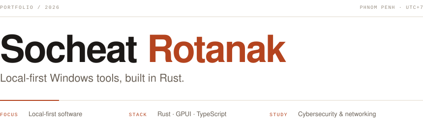
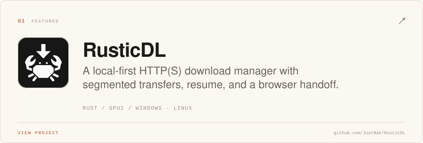
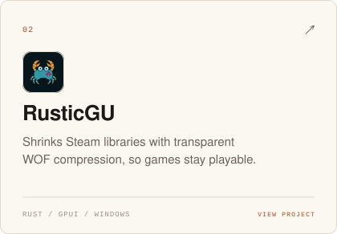
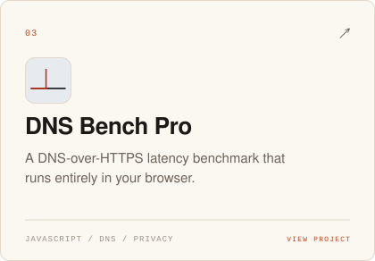
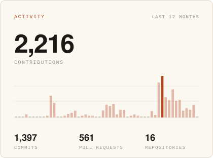
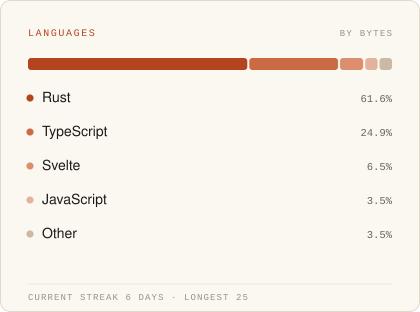

  <picture>
    <source media="(prefers-color-scheme: dark)" srcset="assets/header-dark.svg">
    
  </picture>

Second-year Digital Technologies student at AUPP, studying cybersecurity and networking. I build local-first Windows software in Rust: download managers, library compression, and DNS tooling.

## Selected work

  <a href="https://github.com/JustNak/RusticDL">
    <picture>
      <source media="(prefers-color-scheme: dark)" srcset="assets/rusticdl-card-dark.svg">
      
    </picture>
  </a>

  <a href="https://github.com/JustNak/RusticGU">
    <picture>
      <source media="(prefers-color-scheme: dark)" srcset="assets/rusticgu-card-dark.svg">
      
    </picture>
  </a>
  <a href="https://github.com/JustNak/DNSBenchPro">
    <picture>
      <source media="(prefers-color-scheme: dark)" srcset="assets/dns-card-dark.svg">
      
    </picture>
  </a>

> Building the Rustic apps and studying networking. Breaking my own DNS setup on purpose, then putting it back.

## Activity

  <picture>
    <source media="(prefers-color-scheme: dark)" srcset="assets/activity-dark.svg">
    
  </picture>
  <picture>
    <source media="(prefers-color-scheme: dark)" srcset="assets/languages-dark.svg">
    
  </picture>

---

  <a href="mailto:socheatrotanak@gmail.com">socheatrotanak@gmail.com</a> · <a href="https://github.com/JustNak">github.com/JustNak</a>

